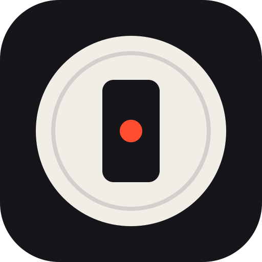
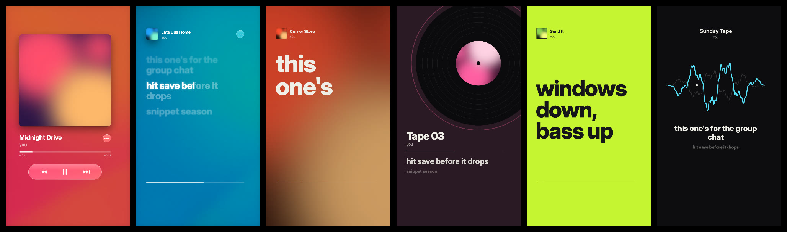

<p></p>

# Waxframe

Your snippet, now playing. Waxframe turns an audio snippet into an Apple Music-style video for Instagram stories, Reels and TikTok: your cover art, your lyrics synced line by line, framed for the feed.

**Live:** https://1jacobl.github.io/waxframe/



## What it does

- **Drop an mp3** (or wav, m4a). Title, artist and cover art are read from the file's ID3 tags.
- **Apple Music-style looks**: Now Playing (your cover alive behind liquid-glass controls) and Lyrics (the active line fills word by word while the rest blur and glide).
- **Four more that react to the music**: Punch (cover hits on every kick), Spin (a record cut by the frame), Type (giant word-by-word lyrics), Scope (the live waveform).
- **Beat detection**: kicks are picked out of the sub-140 Hz band in real time, so the visuals land on the beat in the export too.
- **Any frame**: 9:16 story, 4:5 feed, 1:1, 16:9, or a custom ratio. Text stays clear of the platform's buttons and captions; toggle *Safe zones* to see them.
- **Lyrics**: paste them and tap along while the track plays (space bar works). Fade, pop or karaoke. Import and save `.lrc` files.
- **Trim** the snippet on the waveform, or jump to 15/30/60 seconds.
- **Export** a 1080p MP4 (WebM on browsers without MP4 recording) with the audio.

Everything runs in the browser. Nothing is uploaded.

## Run locally

It is a static site with no build step:

```bash
python3 -m http.server 5173
```

Then open http://localhost:5173.

## Notes

- Export records in real time, so keep the tab visible while it runs.
- MP4 export works in Chrome, Edge and Safari. Firefox exports WebM.
